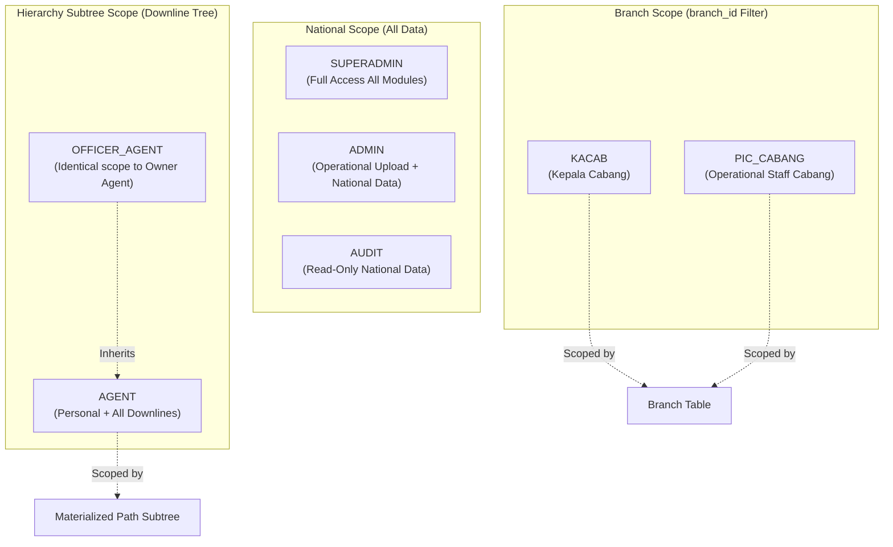

# MitracaMSA — Phase 1 Technical Blueprint
## Modular Insurance Agency Management System

> [!IMPORTANT]
> **Architecture Version:** 1.2.0 | **Updated:** 2026-10-29 | **Status:** Production-Ready Blueprint
> Stack: Next.js 14+ (App Router) · TypeScript · PostgreSQL · Drizzle ORM · Tailwind CSS · Shadcn UI

---

## 1. Role-Based Access Control (RBAC): 7 Roles & Data Scoping

The system enforces strict multi-tenant-like data isolation across seven distinct roles:



### Detailed Role Matrix

| # | Role | Operational Permissions | Data Scope & SQL Filtering Mechanism |
|---|------|-------------------------|--------------------------------------|
| 1 | **`SUPERADMIN`** | Full access to all modules, system configurations, user management, and manual overrides. | **National Scope:** No `WHERE` filter applied. |
| 2 | **`ADMIN`** | Operational Excel file ingestion, batch management, master reconciliation. | **National Scope:** Full read/write across all branches. |
| 3 | **`KACAB`** | Branch performance monitoring, production analytics, downline inspection. | **Branch Scope:** Automatically filtered by `branch_id = session.user.branchId`. |
| 4 | **`PIC_CABANG`** | Operational branch monitoring and localized claim status tracking. | **Branch Scope:** Automatically filtered by `branch_id = session.user.branchId`. |
| 5 | **`AGENT`** | View personal production, commissions, claims, and recursive downline performance. | **Hierarchy Subtree Scope:** Personal record (`id = session.user.agentId`) + all descendants matching `materialized_path LIKE '/<agent_code>/%'`. |
| 6 | **`OFFICER_AGENT`** | Dedicated operational assistant created by an Agent. | **Inherited Agent Scope:** Identical privileges and data scope to their owner agent (`parent_agent_id = owner_agent.id`). |
| 7 | **`AUDIT`** | Read-only compliance review, loss ratio analysis, and transaction tracing. | **National Scope:** Read-only access across all national data without modification rights. |

---

## 2. Fixed Source Excel Templates (Column Mappings)

The ingestion engine strictly maps the following three fixed schemas:

### Template 1: `DataAgent`
*Used to register and maintain the agency hierarchy tree.*

| Excel Header | DB Column | Data Type | Validation & Business Logic |
|---|---|---|---|
| `KODEAGEN` | `agent_code` | `VARCHAR(50)` | Primary unique business identifier. Sanitized (uppercase, trimmed, no special chars). |
| `NAMAAGEN` | `name` | `VARCHAR(255)` | Full Agent name. Default: `"AGEN <KODEAGEN>"` if empty. |
| `NAMACABANG` | `raw_branch_name` | `VARCHAR(255)` | Normalized and auto-provisioned into `branches` table (`branch_id`). |
| `PROFID` | `prof_id` | `VARCHAR(100)` | Profile identification code from legacy system. Indexed. |
| `STATUSKEAGENAN`| `status_keagenan`| `VARCHAR(50)` | Agency active/terminated status (e.g., `"AKTIF"`, `"TERMINATED"`). |
| `KodeUpline` | `upline_agent_code`| `VARCHAR(50)` | **Self-Healing Hook:** If upline is missing, agent is assigned `PENDING_UPLINE`. **Row is not rejected**. |
| `PERINGKAT` | `peringkat` | `VARCHAR(100)` | Agent rank/tier (e.g., Agency Director, Business Manager, Agent). |

---

### Template 2: `MasterProduksi`
*Production transaction feed (policies sold, premiums, and dynamic objects).*

| Excel Header | DB Column | Data Type | Validation & Business Logic |
|---|---|---|---|
| `Bulan` | `bulan` & `period` | `VARCHAR` / `DATE` | Accounting period month (normalized to `YYYY-MM-01`). |
| `Policy Status` | `policy_status` | `VARCHAR(50)` | Current status of policy (Active, Lapsed, Endorsed). |
| `Agent ID` | `source_agent_id` & `agent_id`| `UUID` (FK) | If unknown, auto-provisions placeholder agent (`UNREGISTERED_IN_MASTER`). |
| `Profile ID` | `profile_id` | `VARCHAR(100)` | Profile identifier. |
| `Agent Name` | `agent_name` | `VARCHAR(255)` | Snapshot of agent name at transaction time. |
| `Agent Status` | `agent_status` | `VARCHAR(50)` | Snapshot of status. |
| `Branch` | `raw_branch` & `branch_id` | `UUID` (FK) | Auto-provisions branch master if not yet present. |
| `Representative` | `representative` | `VARCHAR(255)` | Handling representative name. |
| `Product` | `product` | `VARCHAR(255)` | Insurance product line. |
| `Coverage` | `coverage` | `VARCHAR(255)` | Scope of coverage. |
| `Renewed` | `renewed` | `VARCHAR(50)` | Renewal indicator flag. |
| `Prev Policy` | `prev_policy` | `VARCHAR(100)` | Previous policy reference for renewals. |
| `SPAU Type` | `spau_type` | `VARCHAR(100)` | Proposal / SPAU type. |
| `SPAU No` | `spau_no` | `VARCHAR(100)` | SPAU proposal number. |
| `Policy No` | `policy_no` | `VARCHAR(100)` | **Non-Unique:** Multiple entries allowed for endorsements/installment payments across periods. |
| `Start Period` | `start_period` | `DATE` | Coverage inception date. |
| `End Period` | `end_period` | `DATE` | Coverage expiry date. |
| `Insured Name` | `insured_name` | `TEXT` | Policyholder / Insured name. |
| `Currency of TSI`| `currency_tsi` | `VARCHAR(10)` | Currency ISO (e.g. `IDR`, `USD`). |
| `Rate of TSI` | `rate_tsi` | `DECIMAL(18, 4)` | Foreign exchange rate. |
| `TSI` | `tsi` | `DECIMAL(18, 2)` | Total Sum Insured in original currency. |
| `TSI in IDR` | `tsi_in_idr` | `DECIMAL(18, 2)` | Total Sum Insured converted to IDR. |
| `Nilai Premi` | `nilai_premi` | `DECIMAL(18, 2)` | Gross written premium amount. |
| `Nilai Komisi` | `nilai_komisi` | `DECIMAL(18, 2)` | Commission payable to agency. |
| `Nilai Diskon` | `nilai_diskon` | `DECIMAL(18, 2)` | Discount amount applied. |
| `Nilai Akusisi` | `nilai_akusisi` | `DECIMAL(18, 2)` | Policy acquisition costs. |
| `Object Information 1` s/d `15` | `object_details` | `JSONB` | **Dynamic Consolidation:** Columns 1 through 15 are merged into a single indexed JSONB document. |

---

### Template 3: `MasterClaim`
*Claims registered and settled against policies.*

| Excel Header | DB Column | Data Type | Validation & Business Logic |
|---|---|---|---|
| `Agent ID` | `source_agent_id` & `agent_id`| `UUID` (FK) | If unknown, auto-provisions placeholder agent (`UNREGISTERED_IN_MASTER`). |
| `Claim No` | `claim_no` | `VARCHAR(100)` | Claim file reference number. |
| `Policy No` | `policy_no` | `VARCHAR(100)` | Target policy number. |
| `Date Of Settlement` | `date_of_settlement` & `period`| `DATE` | Settlement date (used to derive loss ratio period). |
| `UW Year` | `uw_year` | `VARCHAR(10)` | Underwriting year. |
| `Gross Claim` | `gross_claim` | `DECIMAL(18, 2)` | Primary financial input for Loss Ratio numerator. |
| `Cabang/Branch` | `raw_branch` & `branch_id`| `UUID` (FK) | Auto-provisions branch master. |
| `Nama Produk` | `nama_produk` | `VARCHAR(255)` | Product name. |
| `Currency` | `currency` | `VARCHAR(10)` | Currency code. |
| `Cause of Loss` | `cause_of_loss` | `TEXT` | Peril / loss description. |
| `Indemnity` | `indemnity` | `DECIMAL(18, 2)` | Paid claim indemnity amount. |
| `Deductible` | `deductible` | `DECIMAL(18, 2)` | Policy deductible applied. |
| `Salvage` | `salvage` | `DECIMAL(18, 2)` | Salvage recovered. |
| `Subrogation` | `subrogation` | `DECIMAL(18, 2)` | Subrogation recovered. |

---

## 3. Core Business Logic Implementation

### 3.1 Self-Healing Engine (`PENDING_UPLINE`)
```sql
-- Automated trigger to heal hierarchy branches when an upline is inserted
CREATE OR REPLACE FUNCTION trg_self_heal_hierarchy()
RETURNS TRIGGER AS $$
BEGIN
  IF (NEW.upline_status IN ('LINKED', 'ROOT')) THEN
    UPDATE agents child
    SET 
      parent_id = NEW.id,
      upline_status = 'LINKED',
      materialized_path = COALESCE(NEW.materialized_path, '/' || NEW.agent_code) || '/' || child.agent_code,
      depth = COALESCE(NEW.depth, 0) + 1,
      updated_at = NOW()
    WHERE child.upline_agent_code = NEW.agent_code
      AND child.upline_status = 'PENDING_UPLINE'
      AND child.deleted_at IS NULL;
  END IF;
  RETURN NEW;
END;
$$ LANGUAGE plpgsql;
```

### 3.2 Loss Ratio Formula
$$\text{Loss Ratio} = \left( \frac{\sum \text{Gross Claim}}{\sum \text{Nilai Premi}} \right) \times 100\%$$

Query uses `materialized_path` $O(1)$ prefix search for downline aggregation:
```sql
SELECT 
  sa.agent_code,
  COALESCE(SUM(pr.nilai_premi), 0) AS total_premi,
  COALESCE(SUM(cl.gross_claim), 0) AS total_claim,
  CASE 
    WHEN COALESCE(SUM(pr.nilai_premi), 0) > 0 
    THEN ROUND((COALESCE(SUM(cl.gross_claim), 0) / SUM(pr.nilai_premi)) * 100.0, 2)
    ELSE NULL 
  END AS loss_ratio_pct
FROM agents sa
LEFT JOIN production_records pr ON pr.agent_id = sa.id AND pr.period BETWEEN $1 AND $2
LEFT JOIN claims cl ON cl.agent_id = sa.id AND cl.period BETWEEN $1 AND $2
WHERE sa.materialized_path LIKE '/ROOT_AGENT/%'
GROUP BY sa.agent_code;
```
