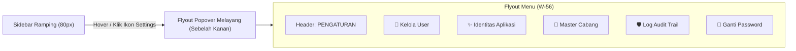

# Rencana Solusi: Akses Menu Pengaturan pada Navigasi Mode Ramping (Collapsed)

Dokumen ini menganalisis kendala akses menu submenu Pengaturan & Administrasi pada saat navigasi berada dalam **Mode Ramping (*Collapsed Sidebar*)** dan menawarkan opsi solusi arsitektur antarmuka terbaik.

---

## 1. Analisis Masalah Saat Ini

Pada [`src/components/navigation/floating-sidebar.tsx`](file:///home/ompiovm/Project/MitracaMSA/src/components/navigation/floating-sidebar.tsx#L272-L395):
* Saat sidebar dalam **Mode Lebar (*Expanded*)**, kelompok **"Pengaturan"** berupa accordion interaktif yang ketika dibuka menampilkan seluruh submenu sesuai peran (RBAC):
  1. 👥 **Kelola User** (`/admin/users`) — *SUPERADMIN*
  2. ✨ **Identitas Aplikasi** (`/settings/app`) — *SUPERADMIN*
  3. 🏢 **Master Cabang** (`/admin/branches`) — *SUPERADMIN & ADMIN*
  4. 🛡️ **Log Audit Trail** (`/admin/audit-logs`) — *SUPERADMIN, AUDIT, & ADMIN*
  5. 🔑 **Ganti Password** (`/settings/change-password`) — *Semua Role*
* Namun saat sidebar beralih ke **Mode Ramping (*Collapsed*)**, komponen saat ini hanya merender **satu ikon roda gigi (*Settings*) tunggal** yang langsung diarahkan ke `/settings/change-password` dengan tooltip teks "Pengaturan":
  ```tsx
  {isCollapsed ? (
    <div className="relative group">
      <Link href="/settings/change-password" ...>
        <Settings className="w-4 h-4" />
      </Link>
      <div className="tooltip">Pengaturan</div>
    </div>
  ) : (
    // Accordion dengan seluruh daftar submenu
  )}
  ```
* **Akibatnya:** Pengguna dengan peran `SUPERADMIN`, `ADMIN`, atau `AUDIT` tidak dapat melihat atau mengakses menu *Kelola User*, *Identitas Aplikasi*, *Master Cabang*, dan *Log Audit Trail* tanpa harus memperlebar (*expand*) sidebar terlebih dahulu.

---

## 2. Opsi Solusi Desain

Berikut adalah 2 opsi solusi standar industri (*modern dashboard UX*):

### 🌟 Opsi 1 (Rekomendasi Utama): *Floating Flyout Popover Menu*
Ketika sidebar dalam Mode Ramping:
* Ikon **Pengaturan** tetap menjadi satu ikon representatif utama di sidebar.
* Saat kursor mengarah (*hover*) atau pengguna mengklik ikon Pengaturan tersebut, muncul panel kartu melayang (*flyout popup card*) di sebelah kanan sidebar (`left-full ml-3 w-56 bg-white rounded-2xl shadow-2xl border border-slate-200/90 p-2 z-50`).
* Di dalam kartu melayang ini ditampilkan:
  - Header kecil: **PENGATURAN & ADMIN**
  - Seluruh tautan submenu lengkap dengan ikon dan teks labelnya (Kelola User, Identitas Aplikasi, Master Cabang, Log Audit Trail, Ganti Password).
  - Tanda status aktif jika salah satu halaman sedang dibuka.



* **Kelebihan Opsi 1:**
  - Sidebar ramping tetap rapi, bersih, dan konsisten (tinggi icon tidak membengkak).
  - Mempertahankan hierarki bahwa menu-menu tersebut adalah bagian dari kelompok *Pengaturan & Administrasi*.
  - Standar UX yang digunakan oleh aplikasi modern (seperti VS Code, Slack, dan dashboard cloud modern).

---

### 🔹 Opsi 2: *Direct Stacked Icons* (Daftar Ikon Mandiri Terpisah)
Ketika sidebar dalam Mode Ramping:
* Semua submenu pengaturan dipecah menjadi deretan ikon vertikal mandiri di bawah garis pemisah (*divider*):
  1. Ikon `Users` $\rightarrow$ Tooltip: "Kelola User"
  2. Ikon `Sparkles` $\rightarrow$ Tooltip: "Identitas Aplikasi"
  3. Ikon `Building2` $\rightarrow$ Tooltip: "Master Cabang"
  4. Ikon `ShieldCheck` $\rightarrow$ Tooltip: "Log Audit Trail"
  5. Ikon `KeyRound` $\rightarrow$ Tooltip: "Ganti Password"
* **Kelebihan Opsi 2:**
  - 1-klik langsung tanpa perlu hover menu melayang.
* **Kekurangan Opsi 2:**
  - Pada layar laptop beresolusi lebih pendek (misal 768px tinggi), total 10-11 ikon vertikal akan membuat sidebar samping cukup padat.
  - Batas hierarki antara menu operasional utama vs menu pengaturan menjadi sedikit kabur di mode samping.

---

## 3. Komparasi Solusi

| Kriteria | Opsi 1: Floating Flyout Popover (Rekomendasi) | Opsi 2: Direct Stacked Icons |
|---|---|---|
| **Kerapian Tampilan** | ⭐⭐⭐⭐⭐ Sangat rapi & elegan | ⭐⭐⭐ Cukup padat vertikal |
| **Kejelasan Hierarki** | ⭐⭐⭐⭐⭐ Tetap terkelompok dalam Pengaturan | ⭐⭐⭐ Melebur menjadi barisan ikon datar |
| **Aksesibilitas Mobile/Tablet** | ⭐⭐⭐⭐⭐ Mendukung Klik & Dismiss di luar | ⭐⭐⭐⭐ Ikon langsung terlihat |
| **Pengalaman Pengguna (UX)** | Standar Dashboard Modern (Linear, VS Code) | Dashboard Klasik |

---

## 4. Rencana Perubahan Teknis (Jika Opsi 1 Dipilih)

### [MODIFY] [`src/components/navigation/floating-sidebar.tsx`](file:///home/ompiovm/Project/MitracaMSA/src/components/navigation/floating-sidebar.tsx)
1. **Perbaikan Overflow Boundary:**
   - Memastikan kontainer sidebar pada mode samping mengizinkan popover melayang tampil keluar batas (`overflow-visible`) agar popup kartu tidak terpotong oleh `overflow-x: hidden`.
2. **State & Event Handler Popover:**
   - Menambahkan state lokal `isFlyoutOpen` dengan dukungan *hover* (delay halus ~150ms agar tidak mudah hilang saat cursor bergeser ke popup) serta dukungan *click toggle* dan *click-outside listener*.
3. **Komponen Flyout Card:**
   - Merender panel melayang berdesain kaca modern (*glassmorphism / white elevated card*) dengan bayangan tebal (`shadow-2xl`), border halus, dan daftar item lengkap sesuai peran pengguna.
   - Setiap item memiliki indikator aktif, efek hover dinamis, dan menutup popover setelah item diklik.

---

## 5. Rencana Verifikasi

1. **Pengujian Tampilan Mode Ramping (*Collapsed*):**
   - Arahkan kursor ke ikon Pengaturan $\rightarrow$ Popover kartu muncul mulus di sisi kanan sidebar.
   - Pindahkan kursor ke dalam kartu popover $\rightarrow$ Kartu tetap terbuka dan item dapat diklik.
   - Klik salah satu menu (misal: *Log Audit Trail* atau *Kelola User*) $\rightarrow$ Rute berpindah seketika dan popover menutup.
2. **Pengujian Role Scoping (RBAC):**
   - Role `SUPERADMIN`: Menampilkan seluruh 5 menu submenu di dalam popover.
   - Role `ADMIN`: Menampilkan Master Cabang, Log Audit Trail, Ganti Password.
   - Role `AUDIT`: Menampilkan Log Audit Trail, Ganti Password.
   - Role `AGENT` / `KACAB`: Menampilkan Ganti Password.
3. **Pengujian Mode Normal (*Expanded*):**
   - Memastikan fungsi accordion di mode lebar tetap bekerja 100% normal tanpa terganggu oleh kode popover.
4. **Verifikasi Kompilasi:**
   - Menjalankan `npx tsc --noEmit` untuk memastikan 0 type error.

---

## 6. Feedback & Konfirmasi User

Mohon konfirmasi pilihan Anda:
1. **Opsi 1 (Rekomendasi):** *Floating Flyout Popover* (Ikon Pengaturan menampilkan menu popup kartu melayang di sisi kanan saat di-hover/klik).
2. **Opsi 2:** *Direct Stacked Icons* (Masing-masing submenu ditampilkan langsung sebagai deretan ikon ke bawah dengan tooltip tersendiri).
