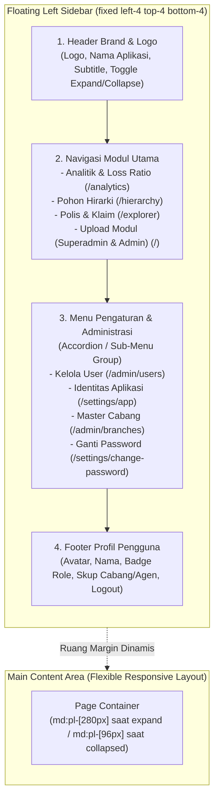

# Rencana Implementasi: Menu Navigasi Kiri Model Floating (Floating Left Sidebar)

Dokumen ini memuat analisis dan rancangan arsitektur untuk memindahkan menu navigasi utama aplikasi dari posisi bilah atas (*top bar*) menjadi **Bilah Samping Melayang di Sebelah Kiri (*Floating Left Sidebar Navigation*)**.

---

## 1. Analisis Kebutuhan & Desain Antarmuka (*Floating Navigation*)

### A. Konsep Floating Sidebar Modern
Navigasi *floating sidebar* (seperti pada antarmuka modern Linear, Supabase, Tailwind UI, atau macOS floating dock) memiliki karakteristik:
1. **Melayang & Memiliki Margin (*Detached Floating*):** 
   * Sidebar tidak menempel kaku ke tepi layar, melainkan melayang dengan jarak tepi yang proporsional (`fixed left-4 top-4 bottom-4 z-40`).
   * Sudut membulat modern (`rounded-2xl` atau `rounded-3xl`), border halus (`border border-slate-200/80`), efek bayangan lembut (*soft elevated shadow* `shadow-xl shadow-slate-900/5`), dan latar belakang semi-transparan berpadu efek kaca (*frosted glassmorphism* `bg-white/90 backdrop-blur-md`).
2. **Dua Mode Tampilan: Expand & Collapse (Icon-Rail):**
   * **Mode Expand (Lebar ~256px / `w-64`):** Menampilkan logo lengkap, label teks menu, badge notifikasi/role, serta profil pengguna lengkap.
   * **Mode Collapsed / Rail (Lebar ~76px / `w-20`):** Menghemat ruang layar horizontal sehingga tabel-tabel data lebar (seperti Analitik dan Explorer) mendapatkan ruang kerja maksimal. Teks disembunyikan dan hanya menampilkan ikon dengan *tooltip* mengambang saat kursor diarahkan (*hover tooltip*).
   * **Tombol Toggle Ekspansi:** Tombol toggle elegan di bagian header/footer sidebar dengan penyimpanan preferensi di `localStorage` pengguna.
3. **Responsif Mobile & Tablet (< 768px):**
   * Di layar ponsel, sidebar disembunyikan secara default dengan tombol pemicu melayang (*floating trigger button*) di sudut kiri atas.
   * Saat tombol ditekan, sidebar meluncur halus (*slide-in drawer*) dari sisi kiri dengan latar belakang gelap lembut (*backdrop blur overlay*).

---

## 2. Struktur Komponen & Hierarki Navigasi

---

## 3. Rincian Elemen Navigasi

### A. Bagian 1: Header Brand (Identitas Aplikasi)
* Terintegrasi dengan `useAppBranding()`:
  * Menampilkan logo gambar kustom atau monogram inisial gradien.
  * Nama aplikasi (`branding.appName`) dan subtitle (`branding.appSubtitle`).
* Tombol Toggle Collapse (`ChevronLeft` / `ChevronRight` atau `PanelLeftClose` / `PanelLeftOpen`):
  * Memungkinkan pengguna mengecilkan atau melebarkan sidebar secara instan.

### B. Bagian 2: Daftar Modul Utama
Tautan menu dengan indikator halaman aktif (*active indicator*):
1. 📈 **Analitik & Loss Ratio** (`/analytics`) — Ikon `TrendingUp`.
2. 🌳 **Pohon Hirarki** (`/hierarchy`) — Ikon `GitFork`.
3. 📑 **Polis & Klaim** (`/explorer`) — Ikon `Layers`.
4. ☁️ **Upload Modul** (`/`) — Ikon `UploadCloud` *(Hanya untuk Superadmin & Admin)*.

### C. Bagian 3: Pengaturan & Administrasi
Dibuat dalam bentuk **Accordion / Collapsible Sub-menu** vertikal:
* Label: **PENGATURAN**
  * 👥 **Kelola User** (`/admin/users`) — *Khusus Superadmin*.
  * ✨ **Identitas Aplikasi** (`/settings/app`) — *Khusus Superadmin*.
  * 🏢 **Master Cabang** (`/admin/branches`) — *Superadmin & Admin*.
  * 🔑 **Ganti Password** (`/settings/change-password`) — *Semua Role*.

### D. Bagian 4: Profil Pengguna & Aksi Cepat (Footer)
* Avatar inisial dengan warna aksen sesuai Role pengguna.
* Nama pengguna dan badge Role (SUPERADMIN, ADMIN, KACAB, AGENT, dll).
* Keterangan lingkup otorisasi (Cabang: X, Agen: 871300, atau Skup: Nasional).
* Tombol cepat **Logout** dengan konfirmasi halus.

---

## 4. Rencana Perubahan Berkas (*Proposed Changes*)

### 1. Komponen Baru: Navigasi Kiri Melayang
* **File Baru:** [`src/components/navigation/floating-sidebar.tsx`](file:///home/ompiovm/Project/MitracaMSA/src/components/navigation/floating-sidebar.tsx)
  * Menggantikan fungsi [`src/components/shared/nav-header.tsx`](file:///home/ompiovm/Project/MitracaMSA/src/components/shared/nav-header.tsx).
  * Mengelola state sesi login, navigasi rute aktif, state *expand/collapse*, dan *mobile drawer*.
  * Menangani pengecualian halaman login (`pathname === '/login'`) agar sidebar tidak muncul di halaman otentikasi.

### 2. Komponen Wrapper Tata Letak Aplikasi (*App Shell*)
* **File Baru / Modifikasi:** [`src/components/navigation/app-shell.tsx`](file:///home/ompiovm/Project/MitracaMSA/src/components/navigation/app-shell.tsx)
  * Menyelaraskan padding kiri konten utama (`transition-all duration-300`) sesuai kondisi sidebar (*Expanded*: `md:pl-72`, *Collapsed*: `md:pl-28`, *Login*: `pl-0`).
  * Menyediakan tombol pemicu menu mobile mengambang (*floating mobile trigger button*) di layar kecil (< md).

### 3. Pembaruan Layout Utama
* **File:** [`src/app/layout.tsx`](file:///home/ompiovm/Project/MitracaMSA/src/app/layout.tsx)
  * Membungkus `{children}` dengan komponen `AppShell` dan `FloatingSidebar` di dalam `BrandingProvider`.

---

## 5. Pertanyaan & Keputusan Desain (Open Questions)

> [!IMPORTANT]
> **Pilihan Gaya Tampilan Default Floating Sidebar:**
> 1. **Default Expanded (Lebar ~256px):** Sidebar terbuka penuh menampilkan ikon + teks saat pertama kali dibuka, dan pengguna dapat mengecilkannya ke mode ikon (*collapse*) kapan saja.
> 2. **Kesesuaian Tampilan Halaman:** Semua halaman dashboard (Analitik, Hierarki, Explorer, Admin Users, Admin Branches) menggunakan wadah `max-w-7xl mx-auto`. Dengan margin kiri floating sidebar, konten halaman akan otomatis bergeser ke tengah dengan proporsi simetris yang sangat rapi.

Apakah rancangan ini sudah sesuai dengan yang Anda bayangkan, dan dapat kita mulai eksekusinya?
