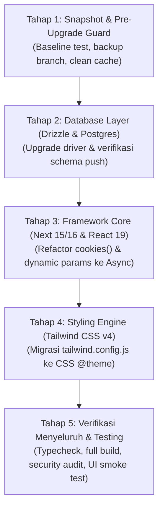

# Peta Jalan Tahapan Refactoring Menyeluruh (Full Modern Stack Migration)

## 1. Goal Description

Dokumen ini memetakan **rencana teknis bertahap (5 Tahap)** untuk memodernisasi codebase **MitracaMSA** dari stack eksisting ke rilis terbaru:
* **Next.js 14.2.35 ➔ Next.js 16 / 15**
* **React 18.3.1 ➔ React 19**
* **Tailwind CSS 3.4.19 ➔ Tailwind CSS 4.3**
* **Drizzle ORM 0.35.3 ➔ 0.45.4** & **Drizzle Kit 0.26 ➔ 0.31**
* **Zod 3.25 ➔ Zod 4.6**

Refactoring dirancang secara **sekuensial dan terisolasi** agar setiap lapisan dapat diverifikasi secara mandiri tanpa menyebabkan *cascade failures*.

---

## 2. Diagram Alur Tahapan Refactoring



---

## 3. Rincian Teknis per Tahap

---

### Tahap 1: Snapshot & Pre-Upgrade Baseline (Persiapan)
Tujuan: Memastikan tidak ada perubahan gantung dan memiliki *restore point* yang aman sebelum modifikasi dependensi.

1. **Pembersihan Cache & Artefak Lama:**
   ```bash
   rm -rf .next node_modules package-lock.json
   ```
2. **Snapshot Baseline:**
   Membuat cadangan arsip branch atau file `.env` & `package.json` lama.
3. **Audit Matrix Dependensi:**
   Menandai library pihak ketiga (`react-dropzone`, `jspdf-autotable`) yang membutuhkan flag `--legacy-peer-deps` atau versi mayor terbaru yang kompatibel dengan React 19.

---

### Tahap 2: Database Layer Modernization (Drizzle ORM & Postgres)
Tujuan: Mengamankan query engine dan menutup kerentanan *SQL identifier escaping (GHSA-gpj5-g38j-94v9)*.

1. **Update Package:**
   ```bash
   npm install drizzle-orm@latest postgres@latest
   npm install -D drizzle-kit@latest
   ```
2. **Refactoring File Konfigurasi:**
   * Memeriksa [`drizzle.config.ts`](file:///home/ompiovm/Project/MitracaMSA/drizzle.config.ts): Memastikan format `defineConfig({ dialect: 'postgresql', ... })` kompatibel dengan Drizzle Kit 0.31+.
   * Memeriksa [`src/db/index.ts`](file:///home/ompiovm/Project/MitracaMSA/src/db/index.ts): Menyesuaikan connection pooling options Postgres client terbaru.
3. **Verifikasi Skema & Type Safety:**
   ```bash
   npm run db:push
   ```

---

### Tahap 3: Next.js 15/16 & React 19 Core Refactoring (Kritis)
Tujuan: Mengadaptasi perubahan arsitektur asynchronous pada Next.js App Router.

#### 1. Refactor Autentikasi (`cookies()` Asynchronous)
* **File:** [`src/lib/auth/session.ts`](file:///home/ompiovm/Project/MitracaMSA/src/lib/auth/session.ts#L69)
* **Perubahan Kode:**
  ```typescript
  // SEBELUM (Next.js 14):
  export async function getServerSession(): Promise<UserSessionPayload | null> {
    const cookieStore = cookies();
    const token = cookieStore.get(SESSION_COOKIE_NAME)?.value;
    ...
  }

  // SESUDAH (Next.js 15/16):
  export async function getServerSession(): Promise<UserSessionPayload | null> {
    const cookieStore = await cookies();
    const token = cookieStore.get(SESSION_COOKIE_NAME)?.value;
    ...
  }
  ```

#### 2. Refactor Dynamic Route Handlers (`params` Promise)
Mengubah penanganan parameter ID di seluruh rute API dinamis (5 rute, 11 endpoint handler):
* [`src/app/api/admin/users/[id]/route.ts`](file:///home/ompiovm/Project/MitracaMSA/src/app/api/admin/users/[id]/route.ts) (`GET`, `PATCH`, `DELETE`)
* [`src/app/api/admin/agents/[id]/route.ts`](file:///home/ompiovm/Project/MitracaMSA/src/app/api/admin/agents/[id]/route.ts) (`GET`, `PATCH`, `DELETE`)
* [`src/app/api/agent/assistants/[id]/route.ts`](file:///home/ompiovm/Project/MitracaMSA/src/app/api/agent/assistants/[id]/route.ts) (`GET`, `PATCH`, `DELETE`)
* [`src/app/api/explorer/policies/[id]/route.ts`](file:///home/ompiovm/Project/MitracaMSA/src/app/api/explorer/policies/[id]/route.ts) (`GET`, `PATCH`)
* [`src/app/api/explorer/claims/[id]/route.ts`](file:///home/ompiovm/Project/MitracaMSA/src/app/api/explorer/claims/[id]/route.ts) (`GET`, `PATCH`)

* **Pola Perubahan Kode:**
  ```typescript
  // SEBELUM (Next.js 14):
  export async function PATCH(
    req: NextRequest,
    { params }: { params: { id: string } }
  ) {
    const { id } = params;
    ...
  }

  // SESUDAH (Next.js 15/16):
  export async function PATCH(
    req: NextRequest,
    { params }: { params: Promise<{ id: string }> }
  ) {
    const { id } = await params;
    ...
  }
  ```

#### 3. Penyesuaian `next.config.mjs`
* Di Next.js 15+, opsi `experimental.serverActions.bodySizeLimit` dipindahkan ke tingkat root `serverActions.bodySizeLimit`:
  ```javascript
  const nextConfig = {
    reactStrictMode: true,
    serverActions: {
      bodySizeLimit: '50mb',
    },
    ...
  };
  ```

#### 4. Update Package Core:
```bash
npm install next@latest react@latest react-dom@latest
npm install -D @types/react@latest @types/react-dom@latest
```

---

### Tahap 4: Tailwind CSS v4 Styling Engine Migration
Tujuan: Memigrasikan sistem tema styling ke arsitektur CSS murni Tailwind v4.

#### 1. Perubahan Dependensi PostCSS
* Hapus `autoprefixer` dan paket `tailwindcss` v3:
  ```bash
  npm uninstall tailwindcss autoprefixer
  npm install @tailwindcss/postcss@latest tailwindcss@latest
  ```
* Perbarui [`postcss.config.js`](file:///home/ompiovm/Project/MitracaMSA/postcss.config.js):
  ```javascript
  module.exports = {
    plugins: {
      '@tailwindcss/postcss': {},
    },
  };
  ```

#### 2. Migrasi dari `tailwind.config.js` ke `globals.css`
* Hapus file `tailwind.config.js`.
* Tulis ulang [`src/app/globals.css`](file:///home/ompiovm/Project/MitracaMSA/src/app/globals.css) menggunakan directive `@theme`:
  ```css
  @import "tailwindcss";

  @theme {
    --color-border: hsl(var(--border));
    --color-input: hsl(var(--input));
    --color-ring: hsl(var(--ring));
    --color-background: hsl(var(--background));
    --color-foreground: hsl(var(--foreground));
    --color-primary: hsl(var(--primary));
    --color-primary-foreground: hsl(var(--primary-foreground));
    --color-secondary: hsl(var(--secondary));
    --color-destructive: hsl(var(--destructive));
    --color-card: hsl(var(--card));
    --color-card-foreground: hsl(var(--card-foreground));
    --radius-lg: var(--radius);
    --radius-md: calc(var(--radius) - 2px);
    --radius-sm: calc(var(--radius) - 4px);
  }
  ```
* Verifikasi utilitas kustom seperti efek *Glassmorphism Card*, opacity slider, dan backdrop blur di halaman `/login` dan `/settings/app`.

---

### Tahap 5: Verifikasi Menyeluruh & Testing (Quality Assurance)
Tujuan: Memastikan tidak ada regresi fungsional atau visual.

1. **Kompilasi TypeScript:**
   ```bash
   npx tsc --noEmit
   ```
   *Target: 0 error tipe.*
2. **Production Build:**
   ```bash
   npm run build
   ```
   *Target: 17 static pages & 31 dynamic API routes terkompilasi sukses.*
3. **Automated Security & Audit:**
   ```bash
   bash .agents/skills/code-security-audit/scripts/run-audit.sh
   ```
   *Target: Bebas kerentanan CVE pada Drizzle dan Next.js.*
4. **Smoke Test Manual:**
   * [ ] **Login & Sesi:** Login dengan akun Superadmin, Admin, Kacab, Agent.
   * [ ] **Master Cabang & Agen:** Uji tambah/edit cabang dan mutasi agen (verifikasi `await params`).
   * [ ] **Upload Pipeline:** Upload file batch Excel klaim/produksi.
   * [ ] **Visual Theme:** Periksa kartu glassmorphism di halaman login.
   * [ ] **Ekspor Laporan:** Unduh laporan PDF dan Excel XLSX.

---

## 4. Estimasi Waktu & Kompleksitas

| Tahap | Kompleksitas | Estimasi Langkah | Tingkat Keberhasilan |
| :--- | :---: | :---: | :---: |
| **Tahap 1: Persiapan** | Rendah | 3 langkah | 100% |
| **Tahap 2: Database Layer** | Sedang | 3 file | 95% |
| **Tahap 3: Next.js Core** | Tinggi | 12 file rute | 90% (butuh ketelitian params) |
| **Tahap 4: Tailwind v4** | Sedang | 3 file styling | 90% |
| **Tahap 5: Verifikasi** | Sedang | 4 tes validasi | 100% |

---

## 5. Keputusan & Persetujuan (User Review Required)

> [!IMPORTANT]
> Apakah Anda menyetujui tahapan refactoring di atas untuk mulai dieksekusi secara bertahap mulai dari **Tahap 1 & Tahap 2**?
