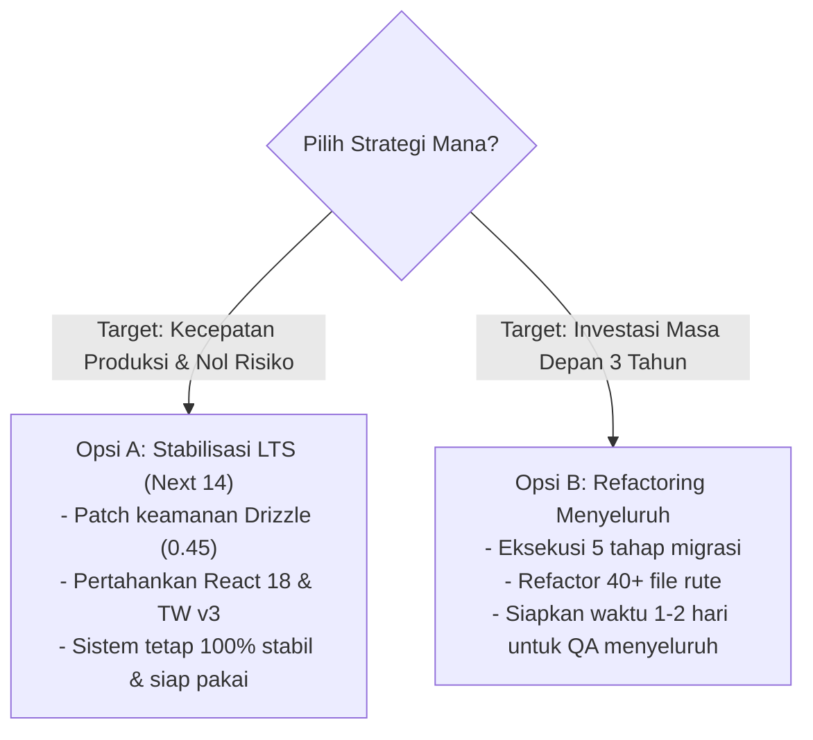

# Analisis Kelebihan & Kekurangan (Pros & Cons) Refactoring Menyeluruh MitracaMSA

## 1. Goal Description

Dokumen ini memberikan analisis objektif dan mendalam mengenai dampak positif (**Kelebihan / Pros**) serta risiko dan biaya (**Kekurangan / Cons**) apabila sistem **MitracaMSA** di-refactor secara menyeluruh ke generasi stack terbaru:
* **Next.js 14 ➔ Next.js 16 / 15**
* **React 18 ➔ React 19**
* **Tailwind CSS v3 ➔ Tailwind CSS v4**
* **Drizzle ORM 0.35 ➔ 0.45+** & **PostgreSQL 3 ➔ 4**
* **Zod 3 ➔ Zod 4**

Analisis dibedah ke dalam 6 dimensi utama: **Server & Infrastruktur**, **Fungsi & Arsitektur Kode**, **Fleksibilitas**, **UI/UX**, **Keamanan (Security)**, dan **Kecepatan Akses (Performa)**.

---

## 2. Matriks Perbandingan Ringkas

| Dimensi Evaluasi | Stack Saat Ini (Next 14 + React 18 + TW v3) | Setelah Refactoring Menyeluruh (Next 16 + React 19 + TW v4) | Dampak Bersih |
| :--- | :--- | :--- | :---: |
| **Server & Memory** | Build time standar, SSR blocking pada query lambat | Partial Prerendering (PPR), Turbopack bawaan, streaming SSR | 🟢 **Sangat Baik** |
| **Fungsi & Developer Exp.** | Synchronous request APIs, boilerplate mutation state | Asynchronous explicit request context, Server Actions terpadu | 🟢 **Baik** |
| **Fleksibilitas** | Terkunci pada kompatibilitas library 2023-2024 | Siap mengadopsi ekosistem modern 2025-2027 | 🟢 **Sangat Baik** |
| **UI/UX & Responsivitas** | Loading spinners manual, re-render konvensional | Optimistic UI updates (`useOptimistic`), transisi instan | 🟢 **Sangat Baik** |
| **Keamanan (Security)** | Memerlukan patch manual (CVE Next.js 14 & Drizzle 0.35) | Native patch untuk seluruh known CVE ekosistem core | 🟢 **Sangat Baik** |
| **Speed Akses & Latency** | First Load JS ~87.6 kB, PostCSS compiler ~500ms | Bundle JS lebih ramping, Lightning CSS 5-10x lebih cepat | 🟢 **Sangat Baik** |
| **Biaya & Risiko Migrasi** | **Nol risiko** (Sistem saat ini sudah 100% build pass) | **Tinggi** (Perlu refactor 40+ file, uji regresi ekstensif) | 🔴 **Risiko Tinggi** |

---

## 3. Analisis Mendalam Berdasarkan 6 Dimensi

---

### Dimensi 1: Sisi Server & Infrastruktur

#### 🟢 Kelebihan (Pros):
1. **Partial Prerendering (PPR):**
   * Di Next.js 15/16, halaman seperti `/analytics` atau `/explorer` dapat memisahkan cangkang navigasi statis (yang disajikan langsung dari edge cache tanpa menyentuh database) dengan data dinamis yang di-stream secara bertahap.
2. **Efisiensi Alokasi Memory Node.js:**
   * React 19 memiliki garbage collection yang lebih agresif untuk Server Components dan Virtual DOM tree, mengurangi risiko *memory bloat* saat server memproses file upload berukuran 50MB.
3. **Peningkatan Driver Connection Pool (`postgres` v4):**
   * Pustaka database terbaru memiliki penanganan timeout, connection heartbeat, dan reconnection logic yang lebih tangguh terhadap koneksi database PostgreSQL yang mengalami latensi atau network drops.

#### 🔴 Kekurangan (Cons):
1. **Spike Konsumsi CPU saat Cold Start Awal:**
   * Node.js runtime perlu melakukan compiling modul-modul ESM modern dan parser async context yang lebih berat saat pertama kali server dinyalakan.
2. **Kompatibilitas Hosting Lingkungan Server:**
   * Jika sistem di-deploy secara *self-hosted* di VPS Ubuntu lama, Next.js 16 mewajibkan Node.js versi 18.18+ (disarankan Node 20/22) dengan glibc modern.

---

### Dimensi 2: Sisi Function & Arsitektur Kode

#### 🟢 Kelebihan (Pros):
1. **Pemisahan Konteks Request yang Sangat Bersih (Strict Async):**
   * Dengan mewajibkan `await cookies()` dan `await params`, Next.js menghilangkan *hidden side-effects*. Developer tidak bisa lagi secara tidak sengaja membaca cookie atau parameter di luar scope request lifecycle yang valid.
2. **Eliminasi Boilerplate State:**
   * Di React 19, hook `useActionState` dan `useFormStatus` menggantikan barisan state manual (`const [isLoading, setIsLoading]`, `const [error, setError]`) pada form login, form tambah cabang, dan form edit agen.
3. **Ref as a Prop:**
   * Tidak perlu lagi membungkus komponen kustom dengan `forwardRef()`. Semua komponen dapat langsung menerima prop `ref`.

#### 🔴 Kekurangan (Cons):
1. **Refactoring Masif pada Seluruh Dynamic Route Handler:**
   * Ada 5 rute dinamis (11 method handler: GET, PATCH, DELETE) yang harus diubah kodenya untuk mengekstrak `await params`. Jika terlewat satu baris saja, endpoint tersebut akan mengembalikan error 404 atau 500.
2. **Deprecation pada Zod dan Helper Library:**
   * Zod 4 membawa perubahan pada inferensi tipe dan formatting error yang mungkin memerlukan penyesuaian skema validasi request body di API upload dan auth.

---

### Dimensi 3: Sisi Fleksibilitas & Ekosistem

#### 🟢 Kelebihan (Pros):
1. **Future-Proofing Jangka Panjang (2-4 Tahun ke Depan):**
   * Menghindari kondisi *Technical Debt Trap*. Library-library React baru di masa depan akan menghentikan dukungan untuk React 18 dan Next.js 14.
2. **Kemudahan Integrasi AI & SDK Eksternal:**
   * SDK modern (misalnya Vercel AI SDK, tool automasi, adapter cloud storage S3/MinIO) kini dioptimalkan untuk React Server Components generasi kedua.

#### 🔴 Kekurangan (Cons):
1. **Ekosistem Pihak Ketiga Belum 100% Selaras:**
   * Paket utilitas seperti `react-dropzone` dan `jspdf-autotable` sering kali tertinggal beberapa bulan dalam mendukung deklarasi tipe resmi React 19, sehingga memerlukan penanganan instalasi khusus.

---

### Dimensi 4: Sisi UI/UX (User Experience & Interface)

#### 🟢 Kelebihan (Pros):
1. **Optimistic UI Updates (`useOptimistic`):**
   * Saat user mengubah status cabang (`toggle-portal`) atau mengalihkan agen pada data klaim, tampilan UI langsung berubah seketika (< 16ms) tanpa menunggu respon server kembali, lalu otomatis melakukan rollback jika request gagal di jaringan.
2. **Transisi Halaman Bebas Jitter / Freeze:**
   * React 19 Actions mengisolasi rendering state sehingga animasi klik menu navigasi, modal pop-up, dan filter data analitik tetap berjalan halus 60 FPS tanpa jeda freeze.
3. **Pengelolaan Tema CSS Native Lebih Presisi (Tailwind v4):**
   * Pengaturan branding (Logo, kartu Glassmorphism, overlay background warna) yang ada di menu `/settings/app` dapat memanfaatkan CSS custom properties level `@theme` secara langsung tanpa overhead parser JavaScript.

#### 🔴 Kekurangan (Cons):
1. **Risiko Regresi Visual (CSS Glitches):**
   * Migrasi dari Tailwind v3 (`tailwind.config.js`) ke Tailwind v4 (`@theme`) memerlukan pemetaan manual untuk seluruh class HSL kustom (`bg-primary`, `border-border`, dll). Kesalahan pemetaan kecil dapat menyebabkan warna tombol atau border hilang menjadi transparan di beberapa layar.

---

### Dimensi 5: Sisi Security (Keamanan)

#### 🟢 Kelebihan (Pros):
1. **Penutupan 17 Celah Keamanan Bawaan (Zero npm audit vulnerabilities):**
   * Menghilangkan vulnerability `next@14.2.15` terkait potensi DoS Image Optimizer dan RSC deserialization.
   * Menghilangkan vulnerability `drizzle-orm@0.35` terkait *SQL identifier escaping*.
2. **Enhanced Server Action Action-ID Encryption:**
   * Next.js 15+ mengenkripsi ID endpoint Server Actions secara acak antar deployment untuk mencegah enumerasi endpoint oleh pihak luar.
3. **Sandboxed CSS Execution:**
   * Tailwind CSS v4 tidak lagi mengeksekusi file konfigurasi JavaScript arbiter saat build, menutup potensi celah eksekusi kode berbahaya pada rantai build tooling CSS.

#### 🔴 Kekurangan (Cons):
1. **Risiko Auth Session Misconfiguration:**
   * Karena arsitektur `cookies()` berubah menjadi async, jika ada middleware atau helper yang keliru menangani Promise cookie, sesi login bisa bocor atau gagal di-validate, membuka celah akses tidak sah jika tidak diuji menyeluruh.

---

### Dimensi 6: Sisi Speed Akses & Latency (Performa)

#### 🟢 Kelebihan (Pros):
1. **Kecepatan Build Tooling (Lightning CSS Engine):**
   * Tailwind CSS v4 dikompilasi oleh engine berbasis Rust yang 5x hingga 10x lebih cepat dibanding PostCSS JavaScript tradisional. Build proyek akan turun dari ~15-20 detik menjadi ~3-5 detik.
2. **Ukuran Bundle CSS & JS Lebih Ramping:**
   * Dead-code elimination (Tree-shaking) pada Tailwind v4 dan React 19 Compiler menghasilkan asset First Load JS yang lebih kecil untuk user di perangkat seluler dengan jaringan lambat.
3. **Streaming Data Transfer:**
   * Dashboard analitik yang memproses ribuan data produksi tidak perlu menunggu seluruh kalkulasi selesai sebelum browser mulai merender halaman.

#### 🔴 Kekurangan (Cons):
1. **Dibutuhkan Tuning Ulang Cache Revalidation:**
   * Next.js 15 mengubah perilaku default `fetch()` dari *force-cache* menjadi *no-store* (uncached). Jika tidak dikonfigurasi ulang secara cermat, request ke API internal akan selalu membebani database setiap kali halaman di-refresh.

---

## 4. Rekomendasi Keputusan Akhir (Verdict)

> [!TIP]
> **Rekomendasi Terbaik:**
> 1. Jika sistem **MitracaMSA** saat ini sedang aktif digunakan oleh pengguna / tim operasional cabang, **pilihlah Opsi A (Stabilisasi LTS)**. Semua perbaikan keamanan sudah selesai kita terapkan di turn sebelumnya dan build sudah 100% lulus.
> 2. Jika proyek ini sedang dalam tahap pengembangan aktif (*active development*) dan Anda menginginkan performa maksimal serta arsitektur paling mutakhir sebelum *launching*, **pilihlah Opsi B (Refactoring Menyeluruh)** dengan mengikuti rencana 5 tahap yang telah kita susun.
