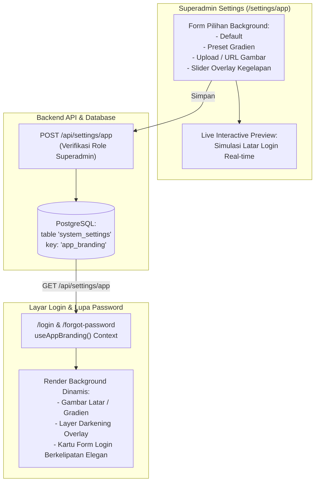

# Rencana Implementasi: Fitur Kustomisasi Background Halaman Login

Dokumen ini merinci rencana teknis penambahan fitur **Kustomisasi Background Halaman Login** yang dapat dikonfigurasi langsung oleh peran **SUPERADMIN** melalui menu **Pengaturan Identitas Aplikasi** (`/settings/app`).

---

## 1. Deskripsi Fitur

Saat ini, halaman login menggunakan latar belakang bawaan (*hardcoded*) berwarna `bg-slate-900` dengan dua lingkaran gradien blur. Agar pihak manajemen dapat menyesuaikan estetika halaman login dengan identitas visual perusahaan (misal menampilkan foto gedung kantor pusat, gedung agensi, atau gradien korporat), sistem akan dilengkapi fitur kustomisasi latar belakang.

### Pilihan Mode Background yang Disediakan:
1. **Mode Default (Bawaan):**
   * Tema Slate-900 klasik dengan aksen cahaya biru/indigo.
2. **Mode Preset Korporat (Pilihan Cepat):**
   * Koleksi gradien modern siap pakai (misal: *Midnight Executive*, *Deep Ocean Blue*, *Emerald Dark*, *Charcoal Luxury*).
3. **Mode Kustom Gambar (Custom Image):**
   * Superadmin dapat **mengunggah file gambar** (JPG/PNG/WebP) atau memasukkan **URL gambar resmi perusahaan**.
   * Dilengkapi pengatur **Overlay Kegelapan (Darkness Overlay 20% - 90%)** dan **Efek Blur Latar** agar teks dan kartu login tetap kontras, elegan, dan mudah dibaca (*WCAG Accessibility Compliant*).

---

## 2. Arsitektur & Alur Data



---

## 3. Rincian Perubahan File

### A. Database Skema & Tipe Data
#### [MODIFY] [`src/db/schema/system-settings.ts`](file:///home/ompiovm/Project/MitracaMSA/src/db/schema/system-settings.ts)
* Memperluas interface `AppBrandingValue`:
  ```typescript
  export type LoginBgType = 'default' | 'preset' | 'image';
  export type LoginBgPreset = 'midnight' | 'ocean' | 'emerald' | 'charcoal';

  export interface AppBrandingValue {
    appName: string;
    appSubtitle: string;
    logoType: 'text' | 'image';
    logoText: string;
    logoUrl?: string | null;
    // Konfigurasi Baru untuk Background Login:
    loginBgType?: LoginBgType;
    loginBgPreset?: LoginBgPreset;
    loginBgUrl?: string | null;      // Base64 atau HTTPS URL
    loginBgOverlay?: number;         // Nilai 20 - 90 (%) untuk opacity overlay
    updatedAt?: string;
  }
  ```

---

### B. Endpoint API
#### [MODIFY] [`src/app/api/settings/app/route.ts`](file:///home/ompiovm/Project/MitracaMSA/src/app/api/settings/app/route.ts)
* **GET Handler:** Mengembalikan nilai `loginBgType`, `loginBgPreset`, `loginBgUrl`, dan `loginBgOverlay` (default ke `'default'`, preset `'midnight'`, overlay `60`).
* **POST Handler:** Validasi input:
  * Memeriksa tipe latar (`'default'`, `'preset'`, atau `'image'`).
  * Jika gambar diunggah/diinput: validasi ukuran file (maks. 3MB) dan format gambar yang aman.
  * Validasi batas overlay numerik (0–100%).

---

### C. State & React Context
#### [MODIFY] [`src/context/branding-context.tsx`](file:///home/ompiovm/Project/MitracaMSA/src/context/branding-context.tsx)
* Menambahkan properti background ke `AppBranding` dan `DEFAULT_BRANDING`.
* Memastikan sinkronisasi hidrasi tetap 100% aman (menggunakan default saat SSR dan diperbarui di client).

---

### D. Tampilan UI Pengaturan Superadmin
#### [MODIFY] [`src/app/settings/app/page.tsx`](file:///home/ompiovm/Project/MitracaMSA/src/app/settings/app/page.tsx)
* Menambahkan seksi baru di formulir: **"Latar Belakang Halaman Login"**:
  1. **Tab Selector Tipe:**
     * `Default Klasik`
     * `Preset Gradien Korporat`
     * `Kustom Gambar Latar`
  2. **Jika memilih Preset:** Menampilkan pilihan swatch warna (Midnight Indigo, Deep Ocean, Emerald Night, Charcoal Minimalist).
  3. **Jika memilih Gambar:**
     * Drag & Drop / Upload file gambar (JPG, PNG, WebP) atau Input URL.
     * Slider interaktif untuk **Intensitas Overlay Kegelapan (Darkness Filter)** dari 20% s/d 90% sehingga teks login selalu kontras.
  4. **Live Preview Section:** Box pratinjau halaman login di sisi kanan langsung mengadaptasi latar belakang yang sedang dipilih secara real-time.

---

### E. Halaman Login & Lupa Password (Desain Baru: Unified Glassmorphism Card)
#### [MODIFY] [`src/app/login/page.tsx`](file:///home/ompiovm/Project/MitracaMSA/src/app/login/page.tsx) & [`src/app/forgot-password/page.tsx`](file:///home/ompiovm/Project/MitracaMSA/src/app/forgot-password/page.tsx)
* **Penyatuan Blok:** Menggabungkan area Logo, Nama Aplikasi, Tagline, dan Formulir Login ke dalam **1 blok kotak terpadu (*Single Unified Card*)**.
* **Efek Glassmorphism (Frosted Glass):**
  * Menggunakan CSS native Tailwind: `backdrop-blur-xl bg-white/85 border border-white/40 shadow-2xl shadow-black/30 rounded-3xl`.
  * Kartu tampak tembus pandang secara mewah membiaskan warna/gambar background di belakangnya, namun teks dan kolom isian tetap 100% kontras dan nyaman dibaca.
* **Performa & Kecepatan:** Murni diproses oleh GPU browser (*hardware-accelerated CSS*), bebas script JS tambahan, 0 ms latency impact.

---

## 4. Rencana Verifikasi & Pengujian

### A. Pengujian Otomatis
1. **Type Check:** Menjalankan `npx tsc --noEmit` untuk memastikan 100% kepatuhan TypeScript pada schema, API handler, dan komponen.
2. **API Endpoint Test:** Menguji `GET /api/settings/app` dan `POST /api/settings/app` dengan payload latar belakang (role SUPERADMIN berhasil, non-superadmin ditolak 403).

### B. Pengujian Manual
1. **Upload Gambar:** Mengunggah file foto kantor/gedung asuransi dan memverifikasi pratinjau langsung di formulir Superadmin.
2. **Slider Overlay:** Menggeser slider kegelapan dan memastikan keterbacaan teks kartu login tetap tajam.
3. **Penyimpanan & Navigasi:** Klik *Simpan Perubahan*, lalu buka halaman `/login` dan `/forgot-password` di tab baru / incognito untuk melihat background baru aktif secara instan.
4. **Reset:** Memastikan tombol *Kembalikan ke Default* dapat mengembalikan tampilan latar belakang ke bentuk bawaan.

---

## 5. Pertanyaan & Konfirmasi

> [!IMPORTANT]
> **Keputusan Desain:**
> Apakah fitur background ini cukup untuk **Halaman Login & Lupa Password**, atau apakah Anda juga menginginkan kustomisasi tema/warna aksen pada halaman internal dashboard di tahap ini? (Rekomendasi saat ini: difokuskan pada Login & Lupa Password sesuai kebutuhan).

Jika rencana ini sudah sesuai dengan kebutuhan Anda, silakan berikan konfirmasi persetujuan agar implementasi koding dapat segera dimulai.
