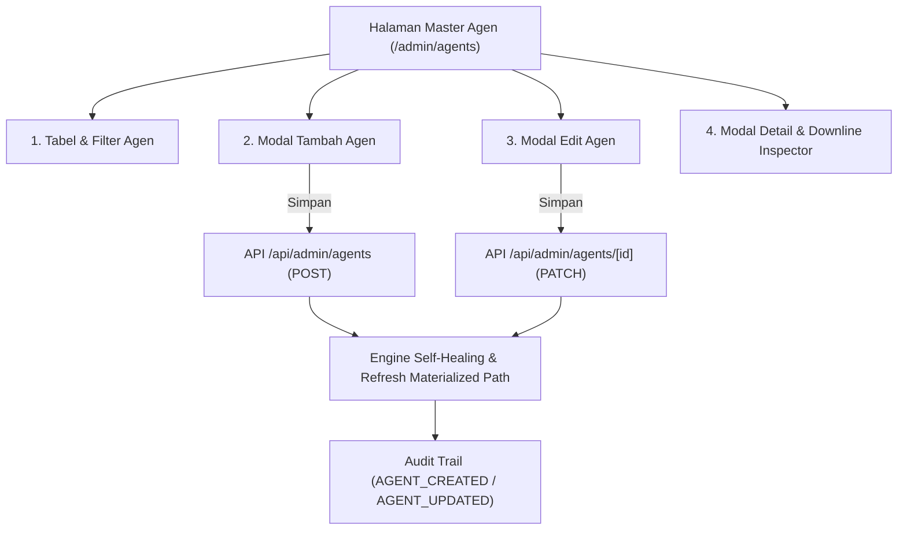

# Rencana Implementasi & Rekomendasi: Modul Master Agen (Tambah, Update, & Kelola Agen)

Dokumen ini menyajikan masukan strategis serta rencana arsitektur teknis untuk membangun fitur **Kelola Master Agen (*Tambah & Update Agen*)** di MitracaMSA.

---

## 1. Analisis & Masukan Penting (Mengapa Fitur Ini Krusial?)

Saat ini, data agen di MitracaMSA hanya dapat masuk melalui dua jalur:
1. **Unggah Berkas Excel (*Template 1: DataAgent*)** via `/upload`.
2. **Auto-Provisioning Agen Sementara (*Placeholder*)** ketika file Produksi / Klaim memuat kode agen yang belum terdaftar di Master.

### ⚠️ Keterbatasan Sistem Saat Ini Tanpa CRUD Agen:
1. **Agen Baru di Pertengahan Bulan:** Jika agen baru closing polis sebelum file bulanan `DataAgent.xlsx` diunggah, agen tersebut hanya tercatat sebagai *placeholder* tanpa nama lengkap atau PROF ID.
2. **Perubahan Upline & Mutasi Agensi:** Ketika agen berpindah upline, dipromosikan (misal: *Agent* $\rightarrow$ *Agency Manager* $\rightarrow$ *Director*), atau berpindah cabang, administrator terpaksa mengedit berkas Excel lalu mengunggah ulang seluruh file.
3. **Koreksi Data Salah Ketik:** Koreksi sederhana pada nama agen, nomor telepon, atau PROF ID tidak dapat dilakukan langsung dari web browser.

---

## 2. Fitur-Fitur Utama yang Direkomendasikan

### A. Halaman Master Agen ([`/admin/agents`](file:///home/ompiovm/Project/MitracaMSA/src/app/admin/agents/page.tsx))
* **4 Kartu Metrik KPI:**
  - Total Agen Terdaftar
  - Agen Status Aktif
  - Agen Placeholder (yang belum dilengkapi profilnya dari upload Produksi/Klaim)
  - Agen Pending Upline (agen yang upline-nya belum terdaftar)
* **Filter & Pencarian Multidimensi:**
  - Pencarian Cepat (*debounced*): Kode Agen, Nama Agen, PROF ID.
  - Filter Cabang Resmi.
  - Filter Status Keagenan (`AKTIF`, `NONAKTIF`, `TERMINATED`).
  - Filter Status Upline (`LINKED`, `PENDING_UPLINE`, `ROOT`).
* **Tabel Interaktif:**
  - Kolom: Kode Agen, Nama Agen, Peringkat/Tier, Cabang, Upline Langsung, Status Keagenan, Status Upline, dan Aksi (Detail, Edit, Nonaktifkan).

### B. Modal Tambah Agen Baru (*Create Agent*)
* **Input Form:**
  1. **Kode Agen** (*Required*, unik, otomatis di-uppercase, misal: `871300`).
  2. **Nama Lengkap Agen** (*Required*).
  3. **PROF ID** (*Opsional*, No. Sertifikasi AAJI/AASI).
  4. **Peringkat / Tier** (Pilihan cepat: `AGENT`, `SENIOR AGENT`, `AGENCY MANAGER`, `AGENCY DIRECTOR`, atau input kustom).
  5. **Cabang Resmi** (Dropdown dari tabel `branches`).
  6. **Upline Agen** (*Searchable Autocomplete Picker* dari master agen yang ada, atau opsi *"Tanpa Upline / Root Leader"*).
  7. **Status Keagenan** (`AKTIF`, `NONAKTIF`, `TERMINATED`).
  8. **Email & Nomor Telepon**.

### C. Modal Edit Agen (*Update Agent*)
* Mengedit identitas agen, cabang penempatan, peringkat, dan status.
* **Perubahan Upline (*Upline Reassignment*):**
  - Dilengkapi **Validasi Anti-Circular Reference**: Sistem secara ketat melarang agen memilih dirinya sendiri atau salah satu *downline*-nya sebagai upline baru (mencegah *infinite loop* pada struktur pohon hirarki).
  - Ketika upline diubah, sistem otomatis mengkalkulasi ulang `materializedPath` dan `depth` agen tersebut serta **seluruh downline di bawahnya secara berantai (*cascading update*)** menggunakan fungsi `refreshAllHierarchyPaths()`.

### D. Modal Detail & Downline Inspector
* Menampilkan:
  - Profil lengkap & metadata agen.
  - Breadcrumb jalur hirarki ke atas (*Ancestor chain*: misal `Root Director > Agency Manager > Agen`).
  - Daftar Downline Langsung (*Level 1 direct downlines*).
  - Ringkasan polis & produksi yang pernah diterbitkan oleh agen ini.

### E. Integrasi Log Audit Trail & Keamanan (RBAC)
* Hak akses dibatasi untuk **SUPERADMIN** dan **ADMIN**.
* Setiap aksi (Tambah Agen, Update Agen, Perubahan Upline, Nonaktifkan Agen) otomatis dicatat ke tabel `audit_logs` melalui `logActivity()`.

---

## 3. Rencana Komponen & File yang Akan Dibangun

### Backend & API
1. **[`src/app/api/admin/agents/route.ts`](file:///home/ompiovm/Project/MitracaMSA/src/app/api/admin/agents/route.ts)**
   - `GET`: Mengambil daftar master agen dengan paginasi, search, filter cabang, status, dan metrik summary KPI.
   - `POST`: Menambah agen baru, memverifikasi keunikan `agentCode`, menghitung `materializedPath` dari upline, dan memicu *self-healing*.
2. **[`src/app/api/admin/agents/[id]/route.ts`](file:///home/ompiovm/Project/MitracaMSA/src/app/api/admin/agents/[id]/route.ts)**
   - `GET`: Mengambil detail lengkap agen, daftar direct downlines, dan statistik produksi.
   - `PATCH`: Mengupdate data profil atau memindahkan upline agen dengan validasi siklus hirarki (*loop prevention*).
   - `DELETE`: Mengubah status agen menjadi non-aktif (*soft delete* / deactivation) untuk melindungi integritas data riwayat polis/klaim.

### Frontend UI
3. **[`src/app/admin/agents/page.tsx`](file:///home/ompiovm/Project/MitracaMSA/src/app/admin/agents/page.tsx)**
   - Halaman utama kelola agen dengan KPI cards, search/filter bar, data table dengan badge status dinamis, dan modal CRUD.
4. **[`src/components/navigation/floating-sidebar.tsx`](file:///home/ompiovm/Project/MitracaMSA/src/components/navigation/floating-sidebar.tsx)**
   - Menambahkan menu **"Master Agen"** dengan ikon `UserCheck` di dalam kelompok Pengaturan & Administrasi.

---

## 4. Rencana Pengujian & Verifikasi

1. **Uji Tambah Agen:**
   - Menambahkan agen baru di bawah upline yang sudah ada $\rightarrow$ pastikan `parentId` dan `materializedPath` terisi tepat.
   - Menambahkan agen baru dengan kode upline yang belum ada $\rightarrow$ pastikan status menjadi `PENDING_UPLINE` (*self-healing compliance*).
2. **Uji Update Upline & Anti-Loop:**
   - Memindahkan upline agen $\rightarrow$ pastikan path seluruh downline ikut ter-update.
   - Menguji pemilihan downline sebagai upline $\rightarrow$ sistem harus menolak dengan pesan error yang jelas.
3. **Uji Pengaruh ke Modul Lain:**
   - Cek halaman **Pohon Hirarki (`/hierarchy`)** $\rightarrow$ agen baru langsung tampil pada diagram pohon dan org chart.
   - Cek halaman **Log Audit Trail (`/admin/audit-logs`)** $\rightarrow$ aktivitas penambahan/perubahan agen tercatat secara real-time.

---

## 5. Pertanyaan & Konfirmasi untuk Anda

Sebelum kita mulai pembuatan kode:
1. Apakah setuju menu ini dinamakan **"Master Agen"** dan ditempatkan di dalam kelompok **Pengaturan & Administrasi** (di bawah Master Cabang)?
2. Apakah hak akses pembuatan/pengeditan agen ini diperuntukkan bagi **SUPERADMIN & ADMIN**, atau khusus **SUPERADMIN** saja?
